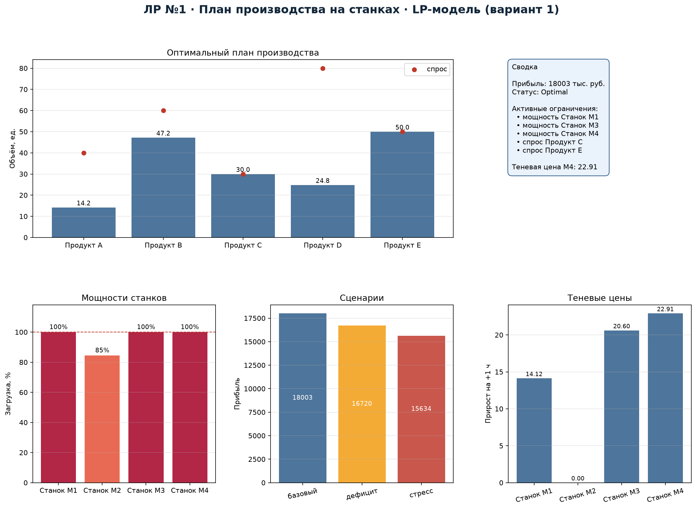
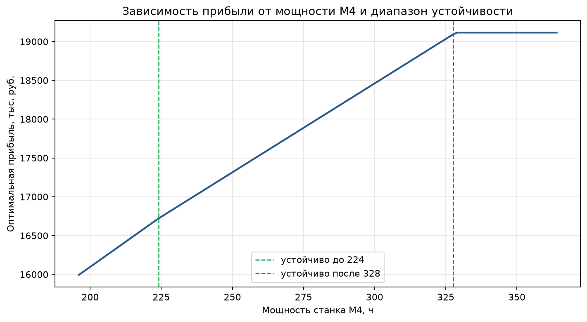
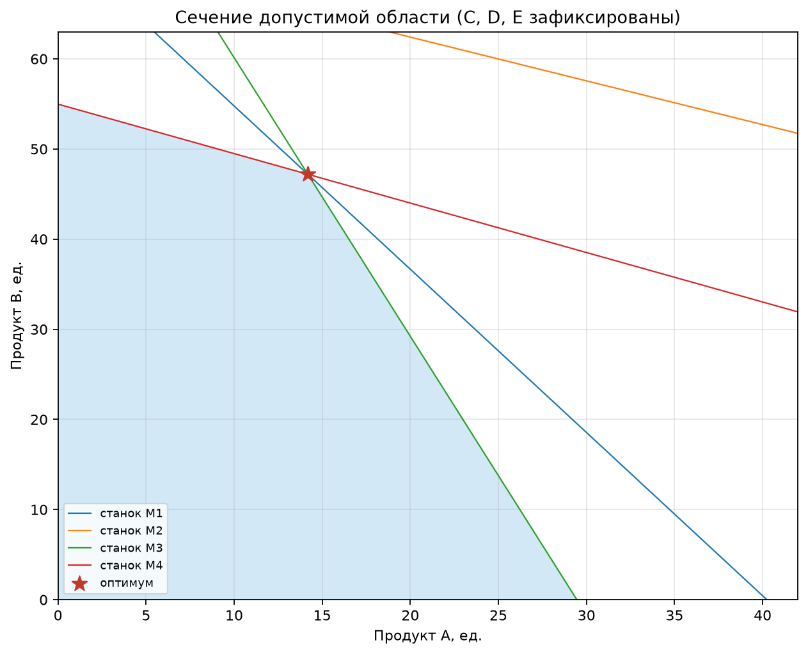

# Лабораторная работа №1
## Линейная модель распределения ресурсов: план производства на станках


**Студент:** Якимов Максим Андреевич  
**Группа:** Б24-517, № 31  
**Вариант:** 1  
**Дисциплина:** «Методы оптимизации. Линейное программирование»
**Репозиторий:** <https://github.com/yakimak/OptLab_1>

---

## Дашборд



## Постановка задачи

5 продуктов, 4 станка. Максимизировать прибыль:

$$\max \sum_{j=1}^{5} c_j x_j$$

при ограничениях на время станков и спрос:

$$\sum_j a_{mj}x_j\le b_m,\quad m=1,\ldots,4;\qquad
0\le x_j\le d_j.$$

Данные — `data/products.csv` и `data/machines.csv`, seed `10131`.
Переменные непрерывные (объёмы производства).

## Результаты

| Продукт | $x_j$, ед. | Спрос |
|---|---:|---:|
| A | 14.18 | 40 |
| B | 47.19 | 60 |
| C | 30.00 | 30 |
| D | 24.78 | 80 |
| E | 50.00 | 50 |

**Прибыль: 18002.54 тыс. руб.** Загрузка: M1 — 100 %, M2 — 84.5 %,
M3 — 100 %, M4 — 100 %. Активны мощности M1, M3, M4 и спрос на C, E.

### Теневые цены мощностей

| Станок | Двойственная оценка |
|---|---:|
| M1 | 14.12 |
| M2 | 0.00 |
| M3 | 20.60 |
| M4 | 22.91 |

Выгоднее всего наращивать M4, затем M3 и M1; M2 не является узким местом.

## Сценарии

| Сценарий | Прибыль |
|---|---:|
| Базовый | 18002.5 |
| Дефицит M4 −20 % | 16719.8 |
| Стресс: M1/M4 −20 %, спрос +10 % | 15634.4 |
| Контрактная перегрузка | infeasible |

Эластичный фильтр для недопустимого контрактного сценария требует суммарного
послабления 32.70 ед. (A — 18.59, B — 8.35, C — 5.76).

## Графики

| Зависимость от мощности M4 | Допустимая область |
|---|---|
|  |  |

## Запуск

```bash
pip install -r requirements.txt
python generate_data.py
python main.py
```

Выход: `results/lab1_solution.csv`, `lab1_scenarios.csv`,
`lab1_shadow_prices.csv`, `lab1_sensitivity.csv`, `solver.log`, PNG-графики.

## Состав сдаваемых материалов

| Требование ТЗ | Файл |
|---|---|
| Исходный код | `main.py`, `generate_data.py` |
| README с установкой и запуском | `README.md` |
| Отчёт PDF / Markdown | `report.pdf`, `report.md` |
| Данные варианта и описание генерации | `data/products.csv`, `data/machines.csv`, `data/README.md` |
| Лог солвера | `results/solver.log` |
| Таблица найденного решения | `results/lab1_plan.csv` |
| Независимая проверка | `results/verification.csv` |
| Сценарные эксперименты | `results/lab1_scenarios.csv` |
| Графики и схемы | `results/lab1_dashboard.png`, `lab1_plan.png`, `lab1_machines.png`, `lab1_shadow.png`, `lab1_sensitivity.png`, `lab1_feasible_region.png` |

## Отчёт

Готовый PDF: [`report.pdf`](report.pdf). Исходник: [`report.md`](report.md).
