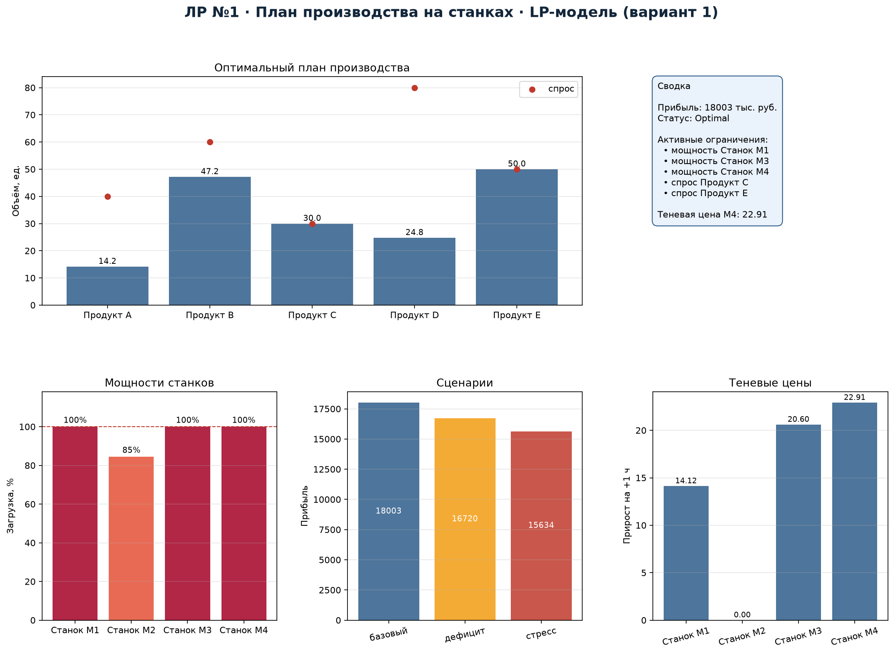
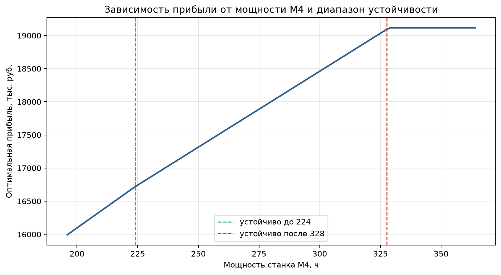
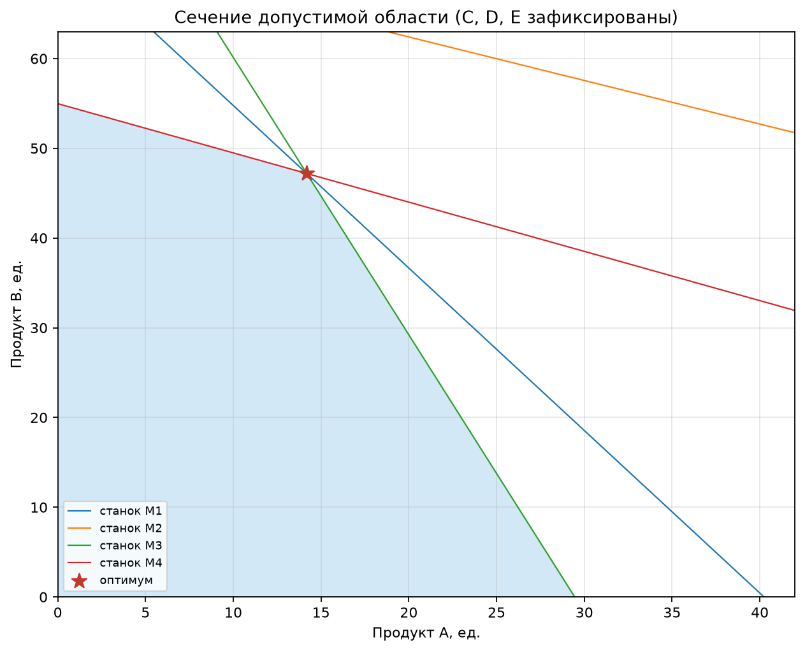

# 1. Постановка задачи и вариант

**Дисциплина:** «Методы оптимизации. Линейное программирование».

**Вариант:** 1 — план производства продукции на станках, максимум прибыли.
Минимальный масштаб: 5 продуктов, 4 станка.

Требуется определить объёмы производства пяти продуктов, максимизирующие
суммарную прибыль при ограничениях на машинное время четырёх станков и
максимальный спрос по каждому продукту.

# 2. Формальная модель

**Множества:** продукты $j\in J=\{A,B,C,D,E\}$; станки $m\in M=\{1,2,3,4\}$.

**Параметры:**

| Обозначение | Смысл | Единица |
|---|---|---|
| $c_j$ | прибыль на единицу продукта | тыс. руб./ед. |
| $a_{mj}$ | трудоёмкость продукта $j$ на станке $m$ | ч/ед. |
| $b_m$ | доступный фонд времени станка $m$ | ч |
| $d_j$ | максимальный спрос на продукт $j$ | ед. |

**Переменные:** $x_j\ge 0$ — объём производства продукта $j$, ед.

**Целевая функция:**
$$\max \sum_{j\in J} c_j x_j.$$

**Ограничения:**
$$\sum_{j\in J} a_{mj}x_j\le b_m,\quad m\in M;\qquad
0\le x_j\le d_j,\quad j\in J.$$

**Допущения:** линейная зависимость времени от объёма; станки независимы;
спрос — верхняя граница, а не обязательство; переналадка и брак не учитываются.

Данные синтетические, seed $=10000+100Q+N=10131$; модель и данные разделены
(`data/products.csv`, `data/machines.csv`).

# 3. Реализация и решение

Модель решается солвером HiGHS через `scipy.optimize.linprog`:
`method="highs"`, двойственный симплекс, `presolve` включён по умолчанию,
допуски по умолчанию $10^{-7}$. Для получения лога установлен
`options={"disp": True}`; лог сохранён в `results/solver.log`. Статус —
`Optimal` (HiGHS Status 7). Независимая проверка на NumPy пересчитывает
загрузку станков, спрос и целевую функцию без обращения к объекту солвера;
её результаты построчно сохранены в `results/verification.csv`.

**Оптимальный план:**

| Продукт | $x_j$, ед. | Спрос | Прибыль, тыс. руб. |
|---|---:|---:|---:|
| A | 14.18 | 40 | 1717.3 |
| B | 47.19 | 60 | 4328.1 |
| C | 30.00 | 30 | 4650.0 |
| D | 24.78 | 80 | 1838.7 |
| E | 50.00 | 50 | 5468.5 |
| **Итого** | | | **18002.5** |

**Загрузка станков:**

| Станок | Использовано, ч | Доступно, ч | Загрузка |
|---|---:|---:|---:|
| M1 | 260.00 | 260 | 100 % |
| M2 | 202.83 | 240 | 84.5 % |
| M3 | 300.00 | 300 | 100 % |
| M4 | 280.00 | 280 | 100 % |

Активные ограничения: мощности M1, M3, M4 и спрос на продукты C и E.
Дефицитными являются станки M1, M3, M4; M2 имеет запас 37.2 ч.

# 4. Независимая проверка

Максимальное нарушение ограничений — $0.0$; решение допустимо. Целевая
функция, пересчитанная на NumPy, совпадает с результатом солвера:
$18002.54$ тыс. руб. Построчная проверка (станки, спрос, неотрицательность,
цель) сохранена в `results/verification.csv`; все строки имеют статус `OK`.
Статус `Optimal` означает, что найден глобальный оптимум непрерывной
LP-модели, а не эвристика.

# 5. Теневые цены

| Ограничение | Двойственная оценка | Конечная разность |
|---|---:|---:|
| Мощность M1 | 14.122 | 14.122 |
| Мощность M2 | 0.000 | 0.000 |
| Мощность M3 | 20.599 | 20.599 |
| Мощность M4 | 22.906 | 22.906 |

Теневые цены совпадают с конечными разностями: увеличение мощности M4 на
1 ч даёт +22.91 тыс. руб. прибыли, M3 — +20.60, M1 — +14.12, M2 — 0.
Следовательно, в первую очередь выгодно наращивать M4, затем M3 и M1;
M2 не является узким местом. Цена M4 остаётся действительной в диапазоне
примерно 224–328 ч (см. анализ устойчивости).

# 6. Сценарный анализ

| Сценарий | Статус | Прибыль, тыс. руб. | Изменение плана |
|---|---|---:|---|
| Базовый | optimal | 18002.5 | A=14.2, B=47.2, C=30, D=24.8, E=50 |
| Дефицит M4 −20 % | optimal | 16719.8 | A↑ до 25.2, B↓ до 38.7, D≈0 |
| Стресс: M1 и M4 −20 %, спрос +10 % | optimal | 15634.4 | B=0, D↑ до 56.5, E=55 |
| Контрактная перегрузка | infeasible | — | минимальные объёмы 30 ед. несовместимы с мощностями |

В дефицитном сценарии уменьшение мощности M4 на 20 % снижает прибыль на
1282.7 тыс. руб. (7.1 %). План перестраивается в пользу продуктов A и C,
а производство D почти прекращается. В стрессовом сценарии одновременное
снижение M1 и M4 и рост спроса дают прибыль 15634.4; продукт B вытесняется.

**Диагностика несовместимости.** В контрактном сценарии (M1, M3, M4 −30 %,
спрос +20 %, минимальные объёмы по 30 ед.) задача недопустима. Эластичный
фильтр минимизирует суммарное послабление контрактов: требуется суммарно
32.70 ед., в том числе A — 18.59, B — 8.35, C — 5.76; по D и E послаблений
не требуется. Это показывает, какие обязательства конфликтуют с мощностями.

# 7. Анализ устойчивости (дополнительное задание)

Для каждого коэффициента прибыли и каждой мощности найдены диапазоны, в
которых не меняется набор активных ограничений. Например, прибыль продукта A
может меняться в диапазоне 60.5–139.2 без смены базиса, продукта C — 
124.0–232.5. Для мощности M4 устойчивый диапазон — 224–328 ч; для M3 —
288–343.5 ч. Это позволяет оценить, насколько исходные экспертные оценки
прибыли и трудоёмкости могут быть неточными, не меняя структуру плана.

# 8. Вывод и ответ на вопрос о практической реализуемости

Оптимальный план использует все мощности M1, M3, M4 и полностью закрывает
спрос на C и E. Он реализуем на практике при условии, что трудоёмкости и
фонды времени определены достоверно; главные ограничения модели — линейная
аппроксимация, отсутствие переналадок, брака и дискретности партий. Для
реального производства потребовалась бы MILP-модель с целыми партиями и
учётом последовательности переналадок. Тем не менее LP-решение даёт
корректную верхнюю оценку и ясные приоритеты расширения мощностей.
